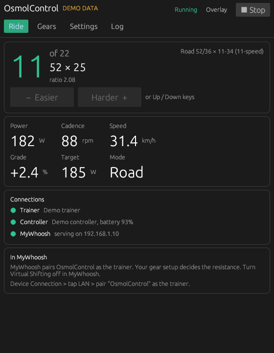
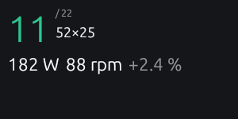
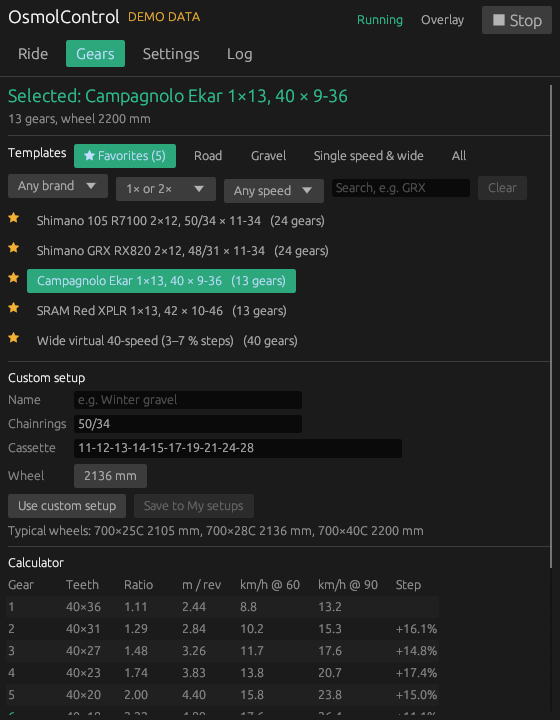
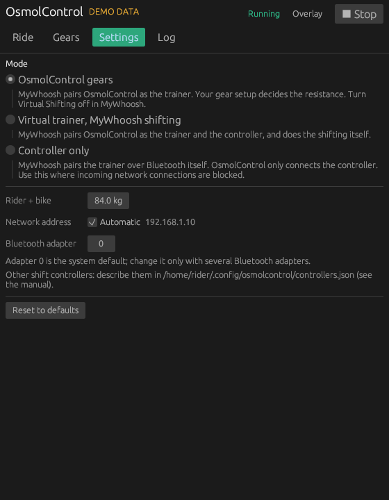

# OsmolControl user manual

OsmolControl connects your smart trainer and your shift controller to
[MyWhoosh](https://mywhoosh.com) and adds **virtual shifting with real gear setups**: pick a
Shimano, SRAM, Campagnolo or Microshift groupset (or type your own), and the trainer's resistance
follows the gear you are in.

- [1. What you need](#1-what-you-need)
- [2. Install](#2-install)
- [3. First ride, step by step](#3-first-ride-step-by-step)
- [4. The app, tab by tab](#4-the-app-tab-by-tab)
- [5. Modes](#5-modes)
- [6. Gears and templates](#6-gears-and-templates)
- [7. Other shift controllers](#7-other-shift-controllers)
- [8. Troubleshooting](#8-troubleshooting)

## 1. What you need

- **A smart trainer with standard FTMS** (Fitness Machine Service) over Bluetooth. Almost every
  current smart trainer has it: Wahoo, Elite, Tacx/Garmin, Saris, JetBlack, Zwift Hub,
  ThinkRider and others. Trainers that only speak ANT+ are not supported.
- **Optional: a shift controller.** The ThinkRider V100 virtual cassette is recognised out of the
  box; others can be added with a small text file ([section 7](#7-other-shift-controllers)).
  Without one you shift with the on-screen buttons or the keyboard.
- **A computer with Bluetooth:** Windows 10/11, macOS 12 or newer, or Linux (Ubuntu, Fedora,
  Arch, CachyOS and similar).
- **MyWhoosh**, either on the same computer or on another device (tablet, phone, PC) on the
  same Wi-Fi/network.

> **Important:** a trainer accepts one Bluetooth app at a time. Do not pair the trainer to
> MyWhoosh, Zwift or a phone app directly while OsmolControl uses it.

## 2. Install

### Windows

1. Download `OsmolControl-Windows.zip` from the project's **Releases** page (or the latest
   *Rust checks* run under **Actions → Artifacts**).
2. Unzip it anywhere, for example to `Documents\OsmolControl`.
3. Double-click **OsmolControl.exe**.
   - *Windows protected your PC* (SmartScreen): click **More info → Run anyway**. The build is
     not code-signed, which is why Windows asks.
   - When Windows Firewall asks, allow OsmolControl on **Private networks**.

### macOS

1. Download `OsmolControl-macOS.tar.gz`, double-click it to unpack, and move the
   **OsmolControl** folder to `~/Applications/OsmolControl`.
2. Open **Terminal** once and run (this only removes the "downloaded from the internet" flag
   from these files; no admin rights needed):

   ```sh
   xattr -dr com.apple.quarantine ~/Applications/OsmolControl
   ```
3. Double-click **osmolcontrol** in that folder. Allow Bluetooth and local network access when
   macOS asks.

### Linux

Open a terminal in the project folder and run:

```sh
packaging/linux/install.sh
```

It works with apt, dnf and pacman, asks for your password once to install system packages,
builds OsmolControl, asks whether you want MyWhoosh or MyWhoosh HD, and installs MyWhoosh under
Proton on the same PC, with desktop and menu shortcuts and automatic game updates. Linux users who only want MyWhoosh can use the standalone installer at
[mywhoosh-linux-installer](https://github.com/Parapeth962/mywhoosh-linux-installer).

## 3. First ride, step by step

1. **Wake up your devices.** Switch the trainer on (pedal a few strokes) and press a button on
   the shift controller.
2. **Start OsmolControl.** The Ride tab opens.
3. **Pick your gears** in the **Gears** tab (see [section 6](#6-gears-and-templates)). The
   default is a common road setup.
4. **Press ▶ Start ride** (top right). OsmolControl finds the trainer and the controller by
   itself. The **Connections** box turns green as each one connects.
5. **Pair in MyWhoosh.** Open MyWhoosh → **Device Connection**:
   - MyWhoosh on another device, Windows or macOS: tap **LAN** and choose **OsmolControl** as
     the Power Source (trainer).
   - MyWhoosh on the same Linux PC (installed by `install.sh`): tap **BLE** and choose
     **OsmolControl** as the Power Source.
6. **Turn off Virtual Shifting in MyWhoosh's settings**, so only one app shifts.
7. **Ride.** Shift with the controller, the **− Easier / Harder +** buttons, or the
   **Up/Down** (or **+/−**) keys. The resistance follows the gear and MyWhoosh's road.
8. When you finish, press **■ Stop** or just close the window. The trainer is reset to its
   normal state.

## 4. The app, tab by tab

### Ride



- **Big number:** current gear, out of the total, with the chainring × cog and the ratio.
- **Power, Cadence, Speed:** live from the trainer. **Grade** is MyWhoosh's current road slope,
  **Target** the power OsmolControl asks the trainer for. **Mode** shows *Road* (gears
  active) or *ERG* (MyWhoosh's workout sets the power; gears pause).
- **Connections:** trainer, controller (with battery) and MyWhoosh, green when connected.
- **In MyWhoosh:** the pairing steps for the selected mode.

### Overlay



Click **Overlay** (top bar) for this small always-on-top window with gear, power, cadence and
grade. Drag it over MyWhoosh. The **− / +** buttons shift; **✕** closes it. On Linux with
Wayland, use your desktop's *Keep above others* window option if it does not stay on top.

### Gears



- **Templates:** pick a group (**★ Favorites**, **Road**, **Gravel**, **Single speed & wide**,
  **All**), then narrow the list with the filters: **brand** (Shimano, SRAM, Campagnolo,
  Microshift, Generic), **1× or 2×**, **speeds** (7 to 13) and a **search** box. **Clear**
  resets the filters. Click a template to select it.
- **Favorites:** click **☆** next to any template to star it (**★**); starred templates are
  listed under **★ Favorites**, which opens first once you have some. Favorites are saved.
- **Custom setup:** type chainrings (`50/34`), cassette (`11-12-13-14-15-17-19-21-24-28`) and
  wheel circumference, then **Use custom setup**. Give it a name and press **Save to My setups**
  to keep it; saved setups appear under **My setups** with *Edit* and *Delete*.
- **Calculator:** every gear with teeth, ratio, metres per pedal turn, speed at 60 and 90 rpm,
  and the step to the next gear. The highlighted gear is where each ride starts.

### Settings



- **Mode:** see [section 5](#5-modes).
- **Rider + bike:** total weight, used for the climbing feel.
- **Network address:** leave on *Automatic* unless your computer has several networks.
- **Bluetooth adapter:** only change with several Bluetooth adapters.
- The folder for extra shift controller profiles is shown at the bottom.

### Log


What happened, in plain words: devices found, connections, gear changes, MyWhoosh taking over
for workouts. Useful when asking for help.

## 5. Modes

| Mode | Who controls the trainer | Who shifts | Use when |
| --- | --- | --- | --- |
| **OsmolControl gears** (default) | OsmolControl | OsmolControl, with your gear setup | You want realistic gears and a real cassette feel |
| **Virtual trainer, MyWhoosh shifting** | OsmolControl | MyWhoosh's own virtual shifting | You prefer MyWhoosh's shifting but want OsmolControl's controller support |
| **Controller only** | MyWhoosh (pairs the trainer itself) | MyWhoosh | Incoming network connections are blocked (e.g. a managed work computer) |

During **ERG workouts** MyWhoosh sets the power; OsmolControl passes it through and your gears
pause until the workout segment ends.

## 6. Gears and templates

Templates cover popular groupsets:

- **Road:** Shimano 105 (11 and 12 speed), Tiagra, Sora, Claris, Tourney; SRAM Red/Force/Rival
  AXS, Apex/Rival/Force 22; Campagnolo Super Record 13 (2×13), Chorus/Record 12,
  Centaur/Potenza/Chorus 11.
- **Gravel:** Shimano GRX (RX400/600/810/820), Claris/Sora gravel; SRAM Red XPLR 1×13, XPLR
  1×12, Apex 1/Rival 1, the 10-52 "mullet"; Campagnolo Ekar 1×13 and Super Record 13 All Road
  2×13; Microshift Advent X.
- **Single speed & wide:** classic single-speed and fixie ratios (one gear: shifting is off,
  only the road changes the effort), and very wide virtual ladders with 30, 35, 40, 45 or 50
  gears in small, even steps, for riders who want fine control.

Shifting works on the whole list from easiest to hardest gear; there is no front-derailleur
logic, so a 2×11 setup is simply 22 gears in order.

Tips:
- **Ride on the big chainring** of your real bike (one fixed cog on the trainer). On the small
  chainring the trainer's flywheel spins slowly and may not reach the resistance of hard gears.
- If the tooth counts of a template differ from your bike, use **Custom setup**.

## 7. Other shift controllers

OsmolControl is **not tied to one trainer or controller**:

- **Trainers:** any trainer advertising standard FTMS is found automatically; its power and
  slope limits are read from the trainer itself. There is no brand-specific code.
- **Controllers:** the ThinkRider V100 is built in. Any controller that sends one fixed
  Bluetooth message per button press can be added without changing the program, by creating
  `controllers.json` in the folder shown in **Settings**:
  - Windows: `%APPDATA%\OsmolControl\controllers.json`
  - macOS and Linux: `~/.config/osmolcontrol/controllers.json`

```json
[
  {
    "label": "My shifter",
    "name_prefixes": ["SHIFTER-"],
    "characteristic": "0000aaaa-0000-1000-8000-00805f9b34fb",
    "shift_up_hex": "0101",
    "shift_down_hex": "0102"
  }
]
```

Find the values with the command line tool: `bikectl scan` shows the controller's advertised
name (use its fixed beginning as `name_prefixes`), `bikectl inspect '<name>'` lists its
characteristics, and `bikectl capture '<name>' '<characteristic>'` prints the bytes each press
sends. Restart the ride after editing; the Log tab confirms how many profiles were loaded.
Controllers with encrypted or press-and-hold protocols (for example Zwift Click/Play) need code
support and cannot be added this way.

## 8. Troubleshooting

| Problem | What to do |
| --- | --- |
| *Still looking for a trainer* | Pedal to wake it. Disconnect it from MyWhoosh, Zwift or phone apps. Check Bluetooth is on. |
| Controller not found | Press a button to wake it. The ride continues without it; use the on-screen buttons. |
| MyWhoosh does not list OsmolControl under LAN | Both devices on the same network; allow OsmolControl in the firewall (Windows asks; Linux with ufw: the Log shows the exact command). On a managed computer try **Controller only** mode. |
| Hard gears feel like they "let go" | Use the big chainring on the real bike. |
| Gears do nothing in MyWhoosh | Mode must be *OsmolControl gears*, and MyWhoosh's Virtual Shifting off. During ERG workouts gears pause by design. |
| Resistance changes on a "flat" road | MyWhoosh's flat routes still have small rises and dips; that is the road, not a fault. |

Still stuck? Copy the **Log** tab and open an issue.
